# Catálogo de efeitos

17 efeitos, um comando cada: `/efeito <comando>`. Todos funcionam em vídeo vertical de alguém falando para a
câmera (horizontal é recortado para 9:16). Os textos que aparecem na tela saem em inglês, como no reel original,
e podem ser trocados em `config.json → "textos"` (exemplos no fim). `*palavra*` destaca na cor do efeito.

**Recorte** = o efeito põe coisas ATRÁS de você usando a máscara da pessoa (Vision, macOS). Fora do macOS
funciona igual, mas esses elementos ficam na frente.

| | comando | apelidos | recorte | usa |
|---|---|---|---|---|
| 1 | [`glass-widgets`](#1-glass-widgets) | vidro, widgets | – | nome, @, avatar, 1º valor do gráfico |
| 2 | [`documentary`](#2-documentary) | documentario | sim | nome completo, @ |
| 3 | [`orbit`](#3-orbit) | orbita | sim | capas (ou quadros do vídeo) |
| 4 | [`kallaway-split`](#4-kallaway-split) | grafico, split | – | gráfico (7 reels + views) |
| 5 | [`spotlight`](#5-spotlight) | holofote, neon | sim | – |
| 6 | [`checklist`](#6-checklist) | lista | – | – |
| 7 | [`timeline`](#7-timeline) | linha-do-tempo, editor | – | quadros do vídeo |
| 8 | [`lineup`](#8-lineup) | arco, cards | sim | – |
| 9 | [`shortcut-rain`](#9-shortcut-rain) | teclas, chuva | – | – |
| 10 | [`red-collage`](#10-red-collage) | vermelho, colagem | sim | – |
| 11 | [`comment-box`](#11-comment-box) | comentario, cta | – | palavra-chave |
| 12 | [`cover-star`](#12-cover-star) | capa, revista | sim | nome |
| 13 | [`headline-wall`](#13-headline-wall) | manchetes, parede | sim | @, soma do gráfico |
| 14 | [`phone-fan`](#14-phone-fan) | celulares, leque | – | capas (ou quadros do vídeo) |
| 15 | [`rabbit-hole`](#15-rabbit-hole) | tunel, molduras | sim | – |
| 16 | [`pastel-word`](#16-pastel-word) | pastel, palavra | sim | nome, @, avatar |
| 17 | [`split-headline`](#17-split-headline) | manchete, titulo | – | – |

---

### 1. glass-widgets
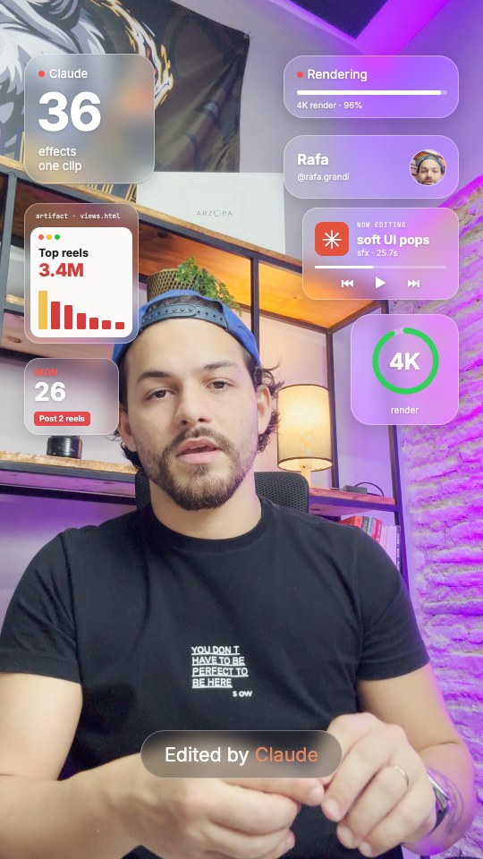

Widgets de vidro fosco surgem em volta da cabeça: contador grande, barra “Rendering”, cartão com seu nome e @,
mini-gráfico “Top reels”, player “NOW EDITING”, anel verde “4K” e agenda do dia. Embaixo, a pílula
“Edited by Claude”. **Bom para:** abrir reel sobre ferramenta/IA, “olha o que dá pra fazer”.

Textos (`"glass-widgets"`): `marca` “Claude” · `numero` “36” · `numeroLegenda` “effects\none clip” ·
`render` · `topReels` · `topValor` (padrão: 1º valor do gráfico) · `agora` · `faixa` “soft UI pops” · `faixaSub` ·
`anel` “4K” · `anelLegenda` · `tarefa` “Post 2 reels” · `selo` “Edited by \*Claude\*”.
<br clear="right">

### 2. documentary
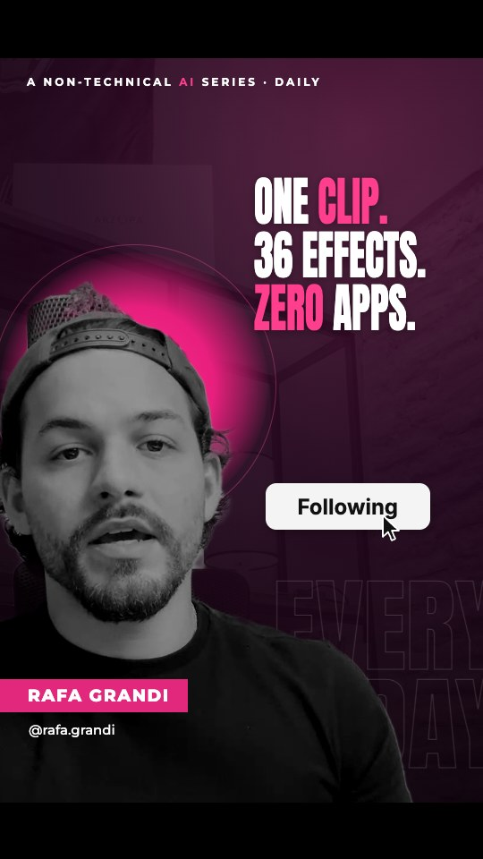

Clarão, e você vira preto e branco sobre fundo magenta escuro, reenquadrado à esquerda com um disco rosa atrás da
cabeça. Três frases são carimbadas uma a uma, sua faixa de nome entra pela esquerda e o cursor clica
Follow → Following. **Bom para:** série diária, bastidor, vídeo “manifesto”.

Textos (`"documentary"`): `serie` “A NON-TECHNICAL \*AI\* SERIES · DAILY” · `linhas` [“ONE \*CLIP.\*”, “36 EFFECTS.”,
“\*ZERO\* APPS.”] · `fantasma` “EVERY\nDAY” · `seguir` · `seguindo`.
<br clear="right">

### 3. orbit
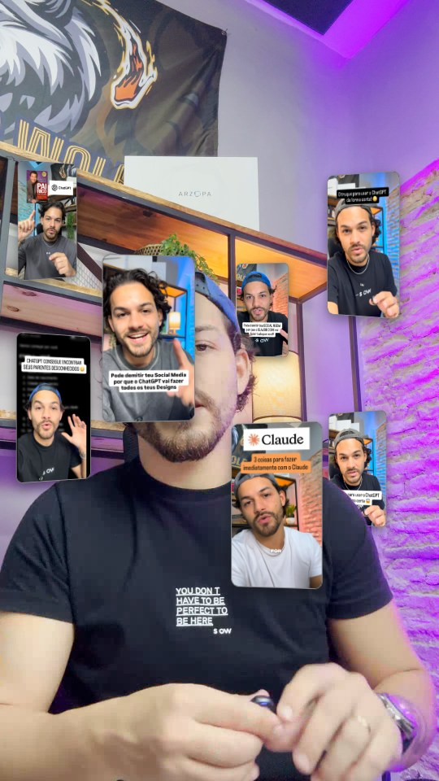

Oito capas dos seus reels giram em volta de você; quando passam por trás, somem atrás do seu corpo.
**Bom para:** “meus melhores vídeos”, prova social, portfólio. Passe `--capas <pasta>` no preparo para usar
capas reais; sem isso, usa quadros do próprio vídeo.
<br clear="right">

### 4. kallaway-split
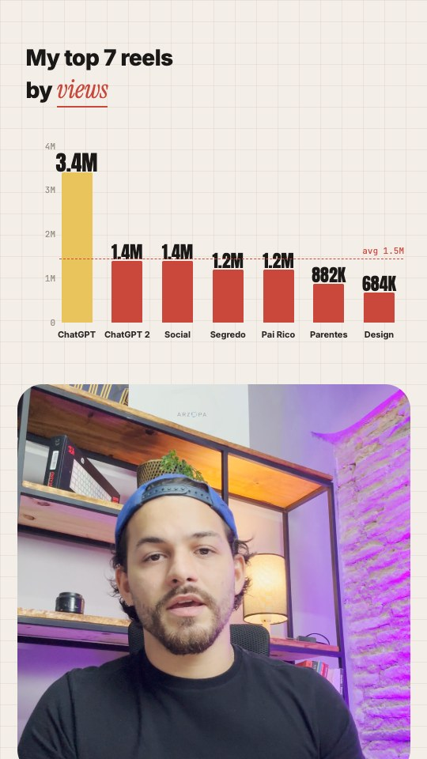

A tela se divide: papel quadriculado em cima com o gráfico “My top 7 reels by views” (barras crescendo, números
contando, linha tracejada da média) e você num card arredondado embaixo. **Bom para:** resultado, números,
“o que funcionou”. Dados em `config.json → "grafico"` (ou `configurar.py --grafico`).

Textos (`"kallaway-split"`): `titulo` · `por` “by” · `destaque` “views” · `media` “avg”.
<br clear="right">

### 5. spotlight
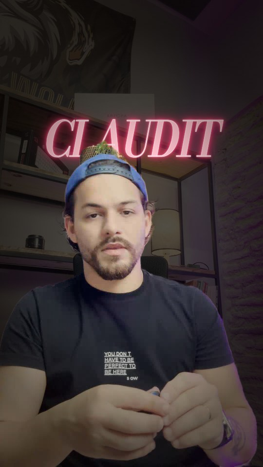

A sala apaga em tom quente, você continua iluminado e um letreiro neon rosa acende (com piscadas) atrás da sua
cabeça. **Bom para:** gancho forte, nome de produto, palavra-chave.

Textos (`"spotlight"`): `palavra` “CLAUDIT”.
<br clear="right">

### 6. checklist
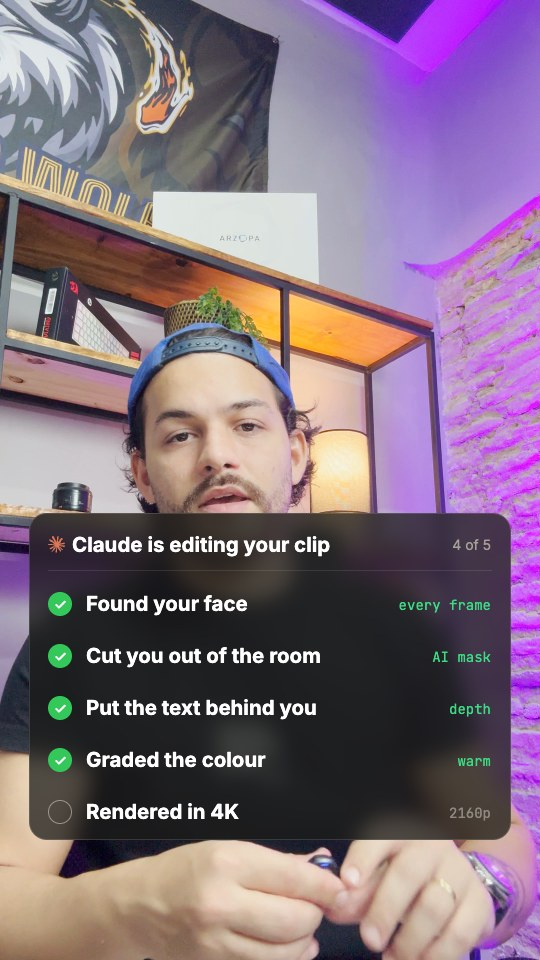

Cartão de vidro escuro “Claude is editing your clip” sobe e marca cada etapa com check verde (“N of 5”).
**Bom para:** passo a passo, processo, tutorial.

Textos (`"checklist"`): `titulo` · `de` “of” · `linhas` [[“Found your face”, “every frame”], … 5 pares].
<br clear="right">

### 7. timeline
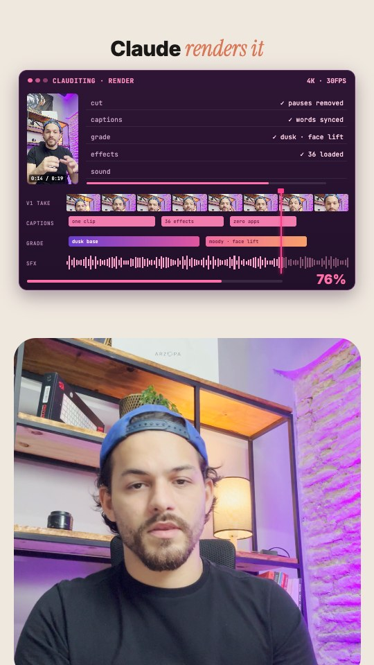

Uma janela roxa de editor aparece (linhas cut/captions/grade/effects/sound, trilha de quadros do seu vídeo,
legendas, cor, onda de som e cursor rosa) e renderiza de 25% a 100%, com o título “Claude renders it” e você embaixo.
**Bom para:** bastidor de edição, “a IA editou isso”.

Textos (`"timeline"`): `titulo` “Claude \*renders it\*” · `janela` · `qualidade` · `linhas` · `legendas` (3) · `cores` (2).
<br clear="right">

### 8. lineup
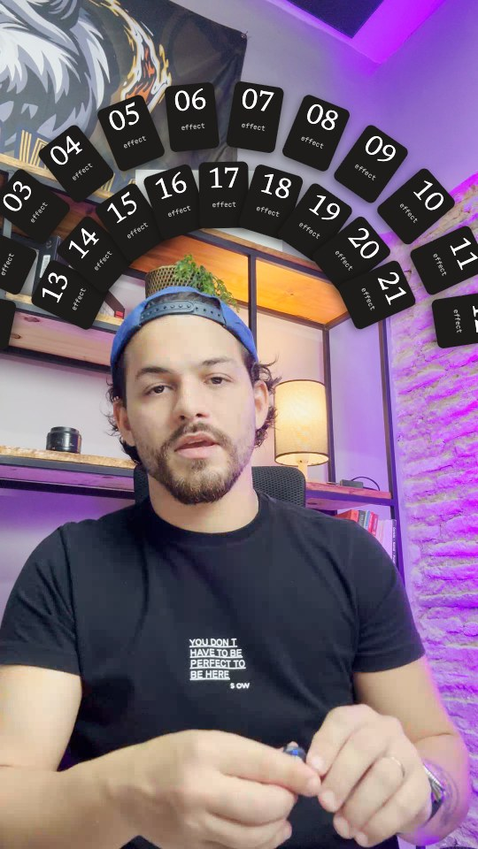

Um arco duplo de 21 cards escuros numerados abre, um por um, atrás da sua cabeça, e balança de leve.
**Bom para:** listas (“21 ferramentas”, “30 dias”), coleção.

Textos (`"lineup"`): `rotulo` “effect” (legenda de cada card).
<br clear="right">

### 9. shortcut-rain
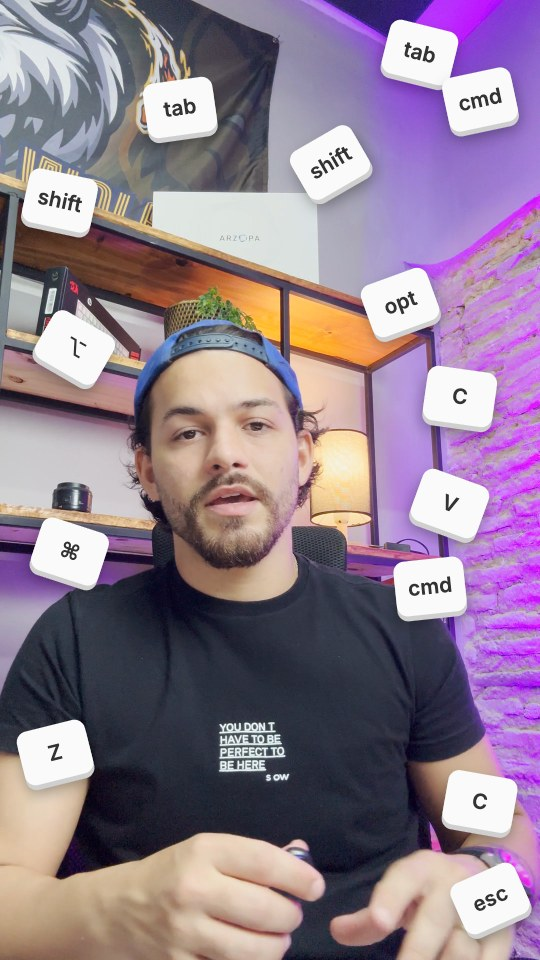

Teclas brancas de atalho (tab, shift, cmd, C, V, esc…) caem do topo, quicam e ficam flutuando em volta.
**Bom para:** produtividade, atalhos, “faça mais rápido”.

Textos (`"shortcut-rain"`): `teclas` (lista de 14 rótulos).
<br clear="right">

### 10. red-collage
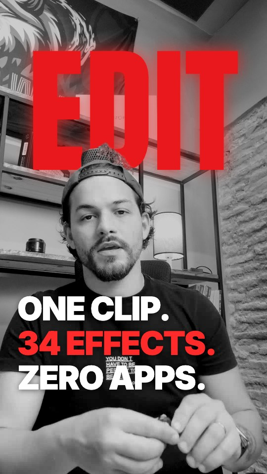

Você em preto e branco com uma palavra vermelha gigante e brilhante atrás da cabeça; embaixo, três frases
carimbadas em sequência. **Bom para:** opinião forte, chamada de impacto.

Textos (`"red-collage"`): `palavra` “EDIT” · `linhas` [“ONE CLIP.”, “\*34 EFFECTS.\*”, “ZERO APPS.”].
<br clear="right">

### 11. comment-box
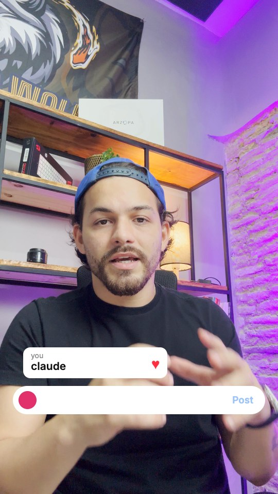

A caixa de comentário do Instagram sobe, digita a palavra-chave, o cursor clica em “Post”, o comentário aparece
e ganha curtida. **Bom para:** CTA “comente X que eu te mando”.

Textos (`"comment-box"`): `palavra` “claude” · `voce` “you” · `publicar` “Post”.
<br clear="right">

### 12. cover-star
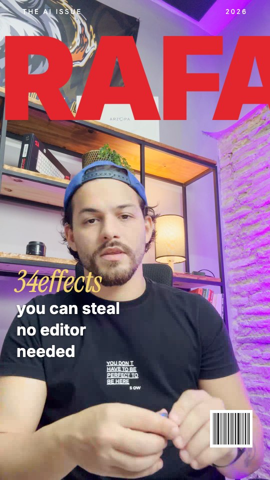

Vira capa de revista: seu nome em vermelho gigante desce atrás da cabeça, cabeçalho da edição, chamada em
itálico dourado, texto de capa e código de barras. **Bom para:** autoridade, conquista, anúncio.

Textos (`"cover-star"`): `edicao` · `ano` · `nome` (padrão: seu nome) · `destaque` “34effects” · `linhas`.
<br clear="right">

### 13. headline-wall
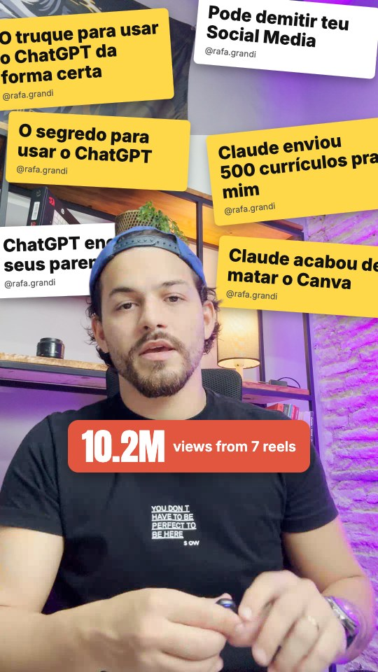

Manchetes amarelas e brancas são coladas, uma a uma, na parede atrás de você; depois entra um selo com o total
de views. **Bom para:** “os vídeos que bombaram”, polêmica, repercussão.

Textos (`"headline-wall"`): `manchetes` (até 6) · `numero` (padrão: soma do gráfico) · `legenda` “views from 7 reels”.
<br clear="right">

### 14. phone-fan
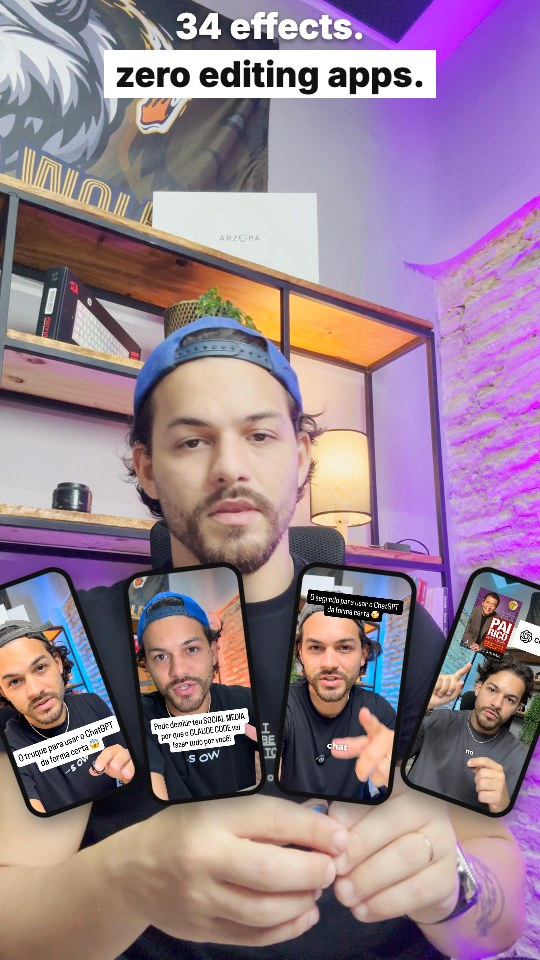

Duas linhas de título no topo e quatro celulares com seus reels sobem e abrem em leque na sua frente.
**Bom para:** “olha esses exemplos”, portfólio, antes/depois.

Textos (`"phone-fan"`): `linha1` “34 effects.” · `linha2` “zero editing apps.”.
<br clear="right">

### 15. rabbit-hole
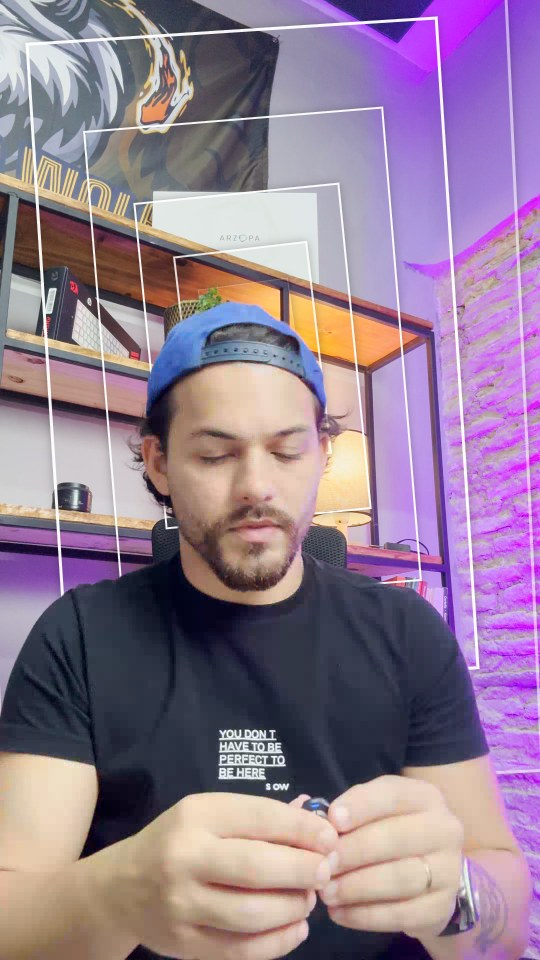

Molduras brancas inclinadas voam do fundo para a frente sem parar, por trás de você, como um túnel infinito.
**Bom para:** “caí na toca do coelho”, curiosidade, mergulho num tema.
<br clear="right">

### 16. pastel-word
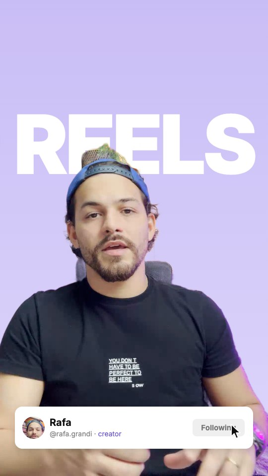

O fundo vira lilás, uma palavra branca gigante sobe atrás de você e um card de perfil (avatar, nome, @) sobe
embaixo, com o cursor clicando em Follow → Following. **Bom para:** marca pessoal, chamada para seguir.

Textos (`"pastel-word"`): `palavra` “REELS” · `rotulo` “creator” · `seguir` · `seguindo`.
<br clear="right">

### 17. split-headline
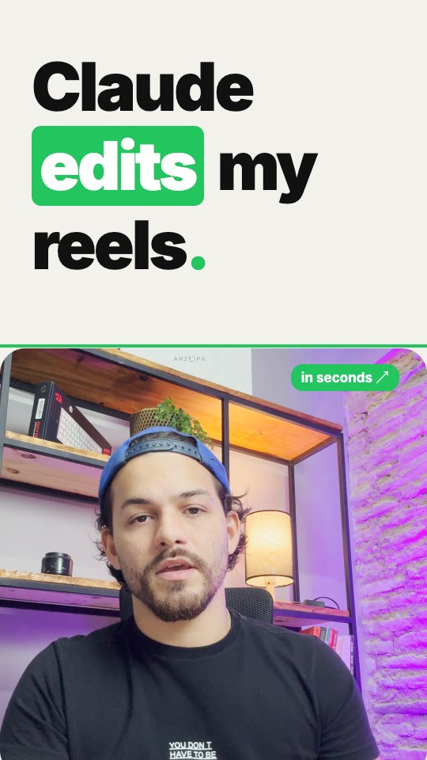

Metade de cima vira papel claro com uma manchete que entra palavra por palavra (uma com destaque verde), uma linha
verde se desenha e um selo “in seconds ↗” aparece; você fica no card de baixo. **Bom para:** gancho escrito, tese.

Textos (`"split-headline"`): `palavras` [“Claude”, “\*edits\*”, “my”, “reels.”] · `selo`.
<br clear="right">

---

## Trocando os textos

```json
{
  "nome": "Rafa",
  "nomeCompleto": "RAFA GRANDI",
  "perfil": "@rafa.grandi",
  "grafico": [{ "rotulo": "ChatGPT", "valor": 3400000 }, { "rotulo": "Social", "valor": 1400000 }],
  "textos": {
    "spotlight": { "palavra": "IA NA VEIA" },
    "documentary": { "linhas": ["UM *CLIPE.*", "17 EFEITOS.", "*ZERO* APPS."] },
    "comment-box": { "palavra": "efeito" },
    "split-headline": { "palavras": ["O", "*Claude*", "edita", "tudo."] }
  }
}
```
