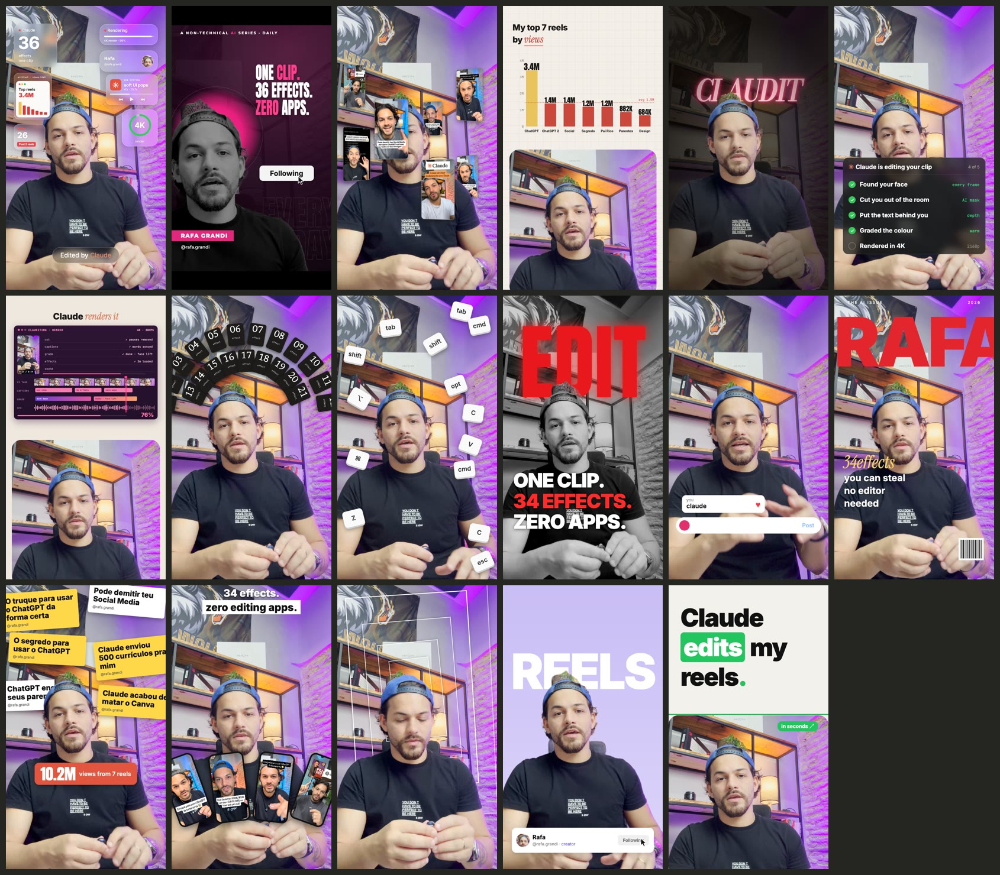

# /efeito — 17 efeitos de vídeo no Claude Code

Um clipe. 17 edições completamente diferentes. Cada uma é **um comando** no Claude Code:

```
/efeito orbit
```

…e você arrasta o seu vídeo no chat. Sem app de edição, sem timeline. O Claude prepara o vídeo, recorta você do
fundo, aplica o efeito e devolve o arquivo pronto, com o seu áudio original. Se o vídeo é HDR (iPhone), a saída
continua HDR.



## Instalar

Precisa de [Claude Code](https://claude.com/claude-code), Node 18+, ffmpeg e Python 3. No macOS, com as Command
Line Tools do Xcode, os efeitos conseguem pôr texto e cards **atrás** de você.

```bash
git clone https://github.com/ohmyjahh/efeitos-claude ~/.claude/skills/efeito && bash ~/.claude/skills/efeito/setup.sh
```

## Usar

```
/efeito glass-widgets        ← e anexe/arraste o vídeo
/efeito spotlight ~/Downloads/IMG_1234.MOV
/efeito lista                ← mostra o catálogo
```

Na primeira vez o Claude pergunta seu nome e @ (aparecem em alguns efeitos). Os textos de cada efeito podem ser
trocados em `config.json` — veja o [catálogo completo](CATALOGO.md).

## Os 17 efeitos

| comando | o que faz |
|---|---|
| `glass-widgets` | widgets de vidro fosco em volta da cabeça + selo “Edited by Claude” |
| `documentary` | P&B sobre magenta, disco rosa atrás da cabeça, palavras carimbadas, Follow → Following |
| `orbit` | capas dos seus reels girando em volta de você |
| `kallaway-split` | gráfico animado dos seus 7 reels mais vistos em cima, você embaixo |
| `spotlight` | apaga a sala e acende um neon atrás da sua cabeça |
| `checklist` | cartão “Claude is editing your clip” marcando cada etapa |
| `timeline` | janela de editor renderizando de 25% a 100%, você embaixo |
| `lineup` | arco de 21 cards numerados atrás da cabeça |
| `shortcut-rain` | teclas de atalho caindo e quicando em volta |
| `red-collage` | P&B com palavra vermelha gigante atrás + 3 frases |
| `comment-box` | campo de comentário digitando a sua palavra-chave (CTA) |
| `cover-star` | capa de revista com seu nome gigante atrás da cabeça |
| `headline-wall` | manchetes coladas atrás + selo de views |
| `phone-fan` | leque de 4 celulares com seus reels |
| `rabbit-hole` | molduras infinitas voando por trás de você |
| `pastel-word` | fundo lilás, palavra gigante atrás, card de perfil |
| `split-headline` | manchete palavra por palavra em cima, você embaixo |

## Como funciona

- `scripts/preparar.py` deixa o vídeo em 1080×1920 / 30 fps, recorta a pessoa (Vision do macOS), mede onde está a
  cabeça e separa quadros, avatar e áudio em `trabalhos/<vídeo>/`.
- Cada efeito é uma composição [Remotion](https://remotion.dev) em `src/efeitos/` que usa a posição da cabeça para
  encaixar o layout em qualquer enquadramento.
- `scripts/renderizar.sh` renderiza e devolve o áudio original. Em vídeo HDR (HLG), renderiza duas passadas e
  `scripts/hdr.py` remonta o vídeo com os códigos HDR originais e a interface convertida para HLG.

Feito com Claude Code por [@rafa.grandi](https://instagram.com/rafa.grandi).
